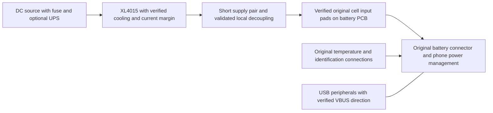

# Mona as an externally powered Linux appliance

[Mona documentation](README.md)

Investigation: 2026-10-16, branch `mona-android16`, live root ADB inspection,
local kernel source, and the primary sources linked below. Device inspection
was read-only. No governor, charging setting, thermal setting, Magisk module,
or battery override was changed, and nothing was flashed or stress-tested.

## Recommended approach

Use a verified battery-replacement supply, retain the original protection and
sensor connections, deploy the existing fake-SOC implementation in the charger
module, and make the Debian supervisor explicitly manage wakefulness. Start
with the stock WALT governor and stock thermal policy. Evaluate the existing
`performance` governor only after testing the supply and cooling under load.

The current kernel already has the performance and wake-lock features needed.
Keep the Mona fragment's `CONFIG_QTI_PMIC_GLINK_CLIENT_DEBUG=y`; no additional
performance Kconfig changes or driver C changes are justified by these findings.
That flag has additional debug controls: see [the fake-SOC guide](fake-soc.md).
USB serial/CP210X, BCL protection, thermal protection, and SELinux remain enabled.

The XL4015 wiring, input source, current limit, exact module components, and
external meter/scope readings have not been supplied. The electrical advice
below is conditional on confirming those details and the original pack topology.
ADB readings alone cannot qualify this assembly for unattended operation.

## What the phone actually reported

Samples were taken at different times during the inspection, mostly with the
display dozing. They are observations, not a sustained-load qualification.

| Item | Observation | Consequence |
| --- | --- | --- |
| Device/software | `mona`, Android 16, build `W1VAS36.62-22-26-7-2-3` | Recheck after OTAs. |
| Running kernel | `6.6.118-4k-g613d3a188049` | Already contains the USB serial changes. |
| Battery | Present, Good, Discharging; 80%; about 4.171–4.174 V, -143 to -148 mA, 24 C | External battery-rail power is still interpreted as battery discharge. |
| Fake SOC | `-22`; running config has the debug option disabled | The observed 80% is not proof that fake SOC works. |
| Charger | `qti_battery_charger` loaded; file at `/vendor_dlkm/lib/modules/qti_battery_charger.ko` | An Image-only update cannot change this driver. |
| OEM battery driver | `qti_glink_charger` and `mmi_charger` also loaded; `mmi_battery` also reports 80% | Check both power supplies and Android after deploying the override. |
| USB/wireless input | Both `online=0`; USB voltage about 5.188 V; Android says unpowered | This is not proof that the physical USB VBUS path is isolated. |
| CPUs | All eight online; CPUs 0–3 up to 1.8048 GHz; CPUs 4–7 up to 2.4 GHz | These are already available stock operating points. |
| CPU policy | WALT on both clusters; big-cluster `scaling_max_freq=1900800` | A 1.9008 GHz policy limit was present during inspection. |
| CPU history | Big-cluster time-in-state includes 2.4 GHz | The hardware has operated above the sampled limit. |
| Thermal state | Framework status 0; all sampled cooling devices at state 0 | No exposed cooling intervention at that instant; this does not exclude other limits. |
| Battery depletion zone | `socd=20`, with trip values 95, 98, 100 | This is depletion percentage, not degrees C. |
| Sleep/tuning | Doze disabled, Battery Saver off, USB autosuspend `-1`, Wi-Fi power saving off | Existing startup script already applies these settings. |
| Wakefulness | Display dozing; `/sys/power/wake_lock` empty; no PowerManager suspend-blocker wake lock | No named appliance wake lock was observed. Other wakeup sources may still be active. |
| Chroot launcher | CPU affinity 0–7, root cpuset | The sampled launcher is not limited to little cores; check actual service workers too. |
| USB peripheral | Realtek `0bda:8153`, Lenovo USB-C to LAN, power control `on` | Ethernet is available; CP210X was not attached during this inspection. |
| SELinux | Enforcing | No policy relaxation is needed for the observed root inspection. |

The pulled running `.config` and the previously generated configuration differ
only in `QTI_PMIC_GLINK_CLIENT_DEBUG` and tool metadata `PAHOLE_VERSION`
(130 versus 131). The previous clean baseline/final configuration comparison
changed only the debug flag. This comparison is not proof of module ABI
compatibility. The earlier validation compiled all three affected driver
objects; it did not produce a deployable vendor module distribution.

## Power delivery with the XL4015

### Supply architecture



Confirm that the cell is completely removed, identify original cell-side and
phone-side pads, and preserve the protection FET/current-sense path. Do not
bridge around the PCB or guess at extra sense/identification pins. The reported
model includes `LS30_ATL_1255MAH` while design capacity is 4870 mAh; neither that
string nor `battery_parallel_cell_count=0/0` establishes the physical cell
topology. Inspect the original pack markings and connections.

For a confirmed single-series-cell replacement rail, approximately 4.1–4.2 V
at the phone under load is a reasonable engineering starting range; the live
phone currently reads about 4.17 V. This is not an OEM-approved batteryless
specification. Do not raise the voltage to make capacity climb. The reported
`voltage_max=4500000` is a charging parameter, not permission to run an
uncharacterized supply at that limit. Never put USB 5 V directly on this rail.

The [XLSEMI datasheet](https://www.xlsemi.com/datasheet/XL4015-EN.pdf) specifies
8–36 V input and 5 A output capability. A regulated 12 V input is within that
range; ordinary 5 V USB input is not. The chip specification does not establish
the continuous rating of a particular module's inductor, diode, capacitors,
connectors, or cooling. Its typical 7 A switch-current limit is not a usable
7 A module rating or a calibrated adjustable output current limit.

Use a current limit above measured startup/workload peaks, within the verified
ratings of the complete path. A module entering constant-current mode lowers
voltage and can reset the phone. At 4.2 V, 5 A corresponds to 21 W before any
needed design margin. Include USB devices powered by the phone in the budget.
If the measured peaks or temperatures exhaust that margin, replace the supply
with a documented converter with adequate transient capacity or a battery
simulator. Choose from measurements, not an advertised current alone.

### Transients, wiring, and cooling

Measure voltage at the phone connector as well as the buck output. Short,
adequately sized paired leads reduce voltage drop and inductance. For example,
0.1 ohm total resistance drops 0.4 V at 4 A. A multimeter or GLINK sample can
miss the short dip that actually causes a reset.

Scope startup, CPU bursts, Ethernet traffic, USB peripheral startup, and sudden
load removal. Use an appropriate probe/ground connection that does not short
the circuit through an earth-referenced instrument. Check ringing, overshoot,
and converter recovery as well as average voltage. TI describes why
[load-transient testing matters](https://www.ti.com/document-viewer/lit/html/SSZTCT1/GUID-6CD38018-D34C-498A-B48E-24947043FB89).

Local decoupling can help, but choose capacitance/ESR with the module's control
loop and inrush limit in mind. As an idealized lower bound, supplying an extra
2 A for 1 ms with at most 0.2 V droop takes `C = I*dt/dV = 10,000 uF`, even
before ESR and wiring effects. A token capacitor cannot replace the original
cell's energy reserve. This calculation is an illustration, not a capacitor
prescription for an unmeasured module. Large added capacitance can create new
startup problems.

Cool the buck's switching device, diode, and inductor as necessary. The XL4015
metal tab is the switching node, per its datasheet: use electrical isolation
where a heatsink could contact grounded metal. For the phone, couple a heatsink
to a verified heat-spreading surface with an electrically insulating thermal
interface and controlled mechanical pressure. Avoid shorts or force on exposed
packages; a phone package may include stacked memory. Check PMIC/board/USB
temperatures too. Cooling only the processor cannot qualify the power path.

### USB charging and reverse power

See [the USB power guide](usb-power.md) for specific ideal-diode boards,
USB role choices, the live Motorola charging-disable control, and a proposed
hardware/software protection plan. That follow-up found usable software
candidates; their electrical effect remains untested.

Treat simultaneous USB/PD/wireless input as a separate electrical design case.
The XL4015 is not specified as a battery simulator that absorbs charge current.
If the phone charges the replacement rail, an ordinary supply can lose voltage
control or receive reverse current. TI's
[charger evaluation guide](https://www.ti.com/lit/ug/sluuab0a/sluuab0a.pdf)
uses a source/sink battery simulator for this reason; its specific circuit is
not a recommendation for this phone.

Prefer a verified USB arrangement in which the phone is the intended host and
external peripheral power cannot feed its VBUS unexpectedly. Powered hubs and
USB-C PD docks differ. Simply cutting VBUS can also break detection, role
negotiation, or the required host supply. A diode protecting the buck alone
does not clamp a battery rail driven upward by the phone's charger.

Do not rely on a late Magisk command to establish electrical isolation: Android
may not have booted yet, and a crash removes that control. Also, this driver's
`charge_control_en` gates SOC-threshold charge control; it is not established
as a master charger-disable switch.
Validate any vendor charging-inhibit control in source and on the actual
hardware before using it. Avoid generic ACC/charging scripts until their
selected node and effect on USB host mode are understood.

## What fake SOC fixes, and what it cannot fix

The existing [capacity getter](../../drivers/power/supply/qti_battery_charger.c)
substitutes only Linux `POWER_SUPPLY_PROP_CAPACITY`. Its setter notifies
power-supply consumers. Voltage, current, and temperature follow their existing
paths; firmware fuel-gauge state does not change.

The [BCL SOC driver](../../drivers/thermal/qcom/bcl_soc.c) reads the named `battery`
supply and computes `100 - capacity`. Therefore a working fake SOC of 80 should
also make `socd` report 20, avoiding depletion-based Linux mitigation as the
original gauge counts down. This is a useful performance effect, but it also
means the override affects consumers beyond Android's percentage display.
It does not disable separate PMIC BCL current/voltage detection or thermal
mitigation. Preserve both `CONFIG_QTI_BCL_PMIC5` and `CONFIG_QTI_BCL_SOC_DRIVER`.

The phone's current Android `Capacity level` is `-1` (unsupported). In
[AOSP Android 16 BatteryService](https://android.googlesource.com/platform/frameworks/base/+/refs/heads/android16-release/services/core/java/com/android/server/BatteryService.java),
that case uses level/presence/charging state for its depleted-battery shutdown
decision. A HAL-reported critical capacity classification is another path.
Thus 80% should address the ordinary framework depletion decision on the
observed setup; verify the OEM health HAL and monitor classification after
deployment. It cannot guarantee that Motorola or Qualcomm firmware has no
other shutdown criterion.

Do not implement the permanent override with `dumpsys battery set level`,
`dumpsys battery unplug`, or a fake `present=false`. AOSP's shell setter enables
`mUpdatesStopped`, freezing the framework's battery snapshot, including its
temperature updates. This phone's command help also explicitly says that
setting a property freezes battery state. `dumpsys battery reset` restores
normal updates if a previous test used simulation.

Deploy the rebuilt **charger module**, with matching symbol versions, signing
policy, and dependencies. The running kernel has `MODVERSIONS=y` and
`MODULE_SIG_PROTECT=y`. Do not force-load a mismatched module or unload the live
charger on the running appliance. A normal Magisk filesystem overlay after a
module has loaded cannot replace its in-memory code; determine the actual boot
load stage before choosing a packaging method. See the
[build/deployment notes](fake-soc.md#configuration-and-build).

If a source change later becomes worthwhile, the focused candidate is a
dedicated fake-SOC Kconfig option guarding the two existing override/notification
sites. That would avoid enabling unrelated firmware debug controls while
retaining `-EINVAL` at probe. It would still require rebuilding/deploying the
module and would not solve a firmware-level cutoff. No C patch is made here.

Manual activation and restoration, inside `adb shell` followed by `su`:

```sh
echo 80 > /sys/class/qcom-battery/fake_soc
cat /sys/class/qcom-battery/fake_soc
cat /sys/class/power_supply/battery/capacity
cat /sys/class/power_supply/mmi_battery/capacity
dumpsys battery
for z in /sys/class/thermal/thermal_zone*; do
    [ "$(cat "$z/type")" = socd ] && cat "$z/temp"
done
# Restore the driver default when finished:
echo -22 > /sys/class/qcom-battery/fake_soc
```

No boot activation is added. A reboot resets the override, so unattended reboot
recovery is not solved by a manual override alone. If automatic activation is
explicitly chosen later, make it a separate opt-in policy, apply it early enough
to beat framework depletion handling, and verify supply presence independently.
Do not wait for a depleted phone to finish booting before addressing that race.
Keeping the default inactive remains the current requirement.

## Performance and service lifecycle

### Preserve thermal management and investigate the existing cap

The big cluster exposes 2.4 GHz but was repeatedly limited to 1.9008 GHz during
the inspection. The Qualcomm performance max-vote node at
`/sys/kernel/msm_performance/parameters/cpu_max_freq` showed the unconstrained
value `2147483647` on all cores, and thermal cooling states were zero. The
source of the remaining limit is unresolved; do not label it battery throttling
without a controlled comparison. Vendor services or another frequency QoS
request may own it.

The live `/vendor/etc/thermal-engine-mona.conf` contains CPU limits based on
virtual board/skin sensors, including a 1.9008 GHz action. That identifies one
possible policy path, not proof that it was active. Stock Power HAL, perfservice,
thermal-engine, and thermal HAL were running. Compare frequency limits with
display state, workload, board temperatures, and power hints before changing a
policy. Read `cpuinfo_cur_freq` as well as `scaling_cur_freq`; a requested
frequency alone does not prove delivered performance.

Android's [fixed performance mode](https://developer.android.com/games/optimize/adpf/fixed-performance-mode)
selects a repeatable operating point rather than maximum throughput. It is not
the appliance tuning switch to use. This phone's vendor sustained-performance
profile also contains lower frequency caps. Avoid enabling either blindly.

Stock thermal policy can react to battery power constraints as well as
temperature; Android documents these roles in its
[thermal mitigation guide](https://source.android.com/docs/core/power/thermal-mitigation).
Do not stop thermal-engine, spoof temperatures, disable BCL, or keep overwriting
thermal frequency limits. The sampled HAL thresholds are policy reports, not
safe temperatures to target. A heatsink can improve sustained stock clocks
without changing those protections.

### Controlled governor comparison

The running kernel already has `CONFIG_CPU_FREQ_GOV_PERFORMANCE=y`, and
`performance` is listed in both policies. After supply qualification, compare
WALT and performance under the real workload with the display off. The
[performance governor](https://docs.kernel.org/admin-guide/pm/cpufreq.html)
requests each policy's highest permitted frequency; it does not defeat other
limits or create higher hardware operating points.

Example reversible test, in one root shell. Save these values before applying
the test, and run the restoration even if the workload fails:

```sh
p0=/sys/devices/system/cpu/cpufreq/policy0
p4=/sys/devices/system/cpu/cpufreq/policy4
old_gov0=$(cat "$p0/scaling_governor")
old_gov4=$(cat "$p4/scaling_governor")
echo performance > "$p0/scaling_governor"
echo performance > "$p4/scaling_governor"
# Run the intended workload and record throughput, latency, volts and temperatures.
# Restore in this same shell:
printf '%s\n' "$old_gov0" > "$p0/scaling_governor"
printf '%s\n' "$old_gov4" > "$p4/scaling_governor"
```

For a later test of the 1.9008 GHz cap, first establish that the supply is sound
and the cap is an ordinary user policy rather than an active protective request.
Save `scaling_max_freq`, request the advertised `cpuinfo_max_freq` once, and
inspect the effective readback. A lower readback or a returning limit calls for
tracing its owner, not a loop that fights it. Restore the previous user setting
after the experiment. No such write was made in this investigation.

The local [Qualcomm CPUFreq driver](../../drivers/cpufreq/qcom-cpufreq-hw.c) reads
hardware frequency/voltage lookup tables. Overclocking beyond 2.4 GHz is not a
defconfig toggle; it would require platform-specific clock/voltage/firmware
work and electrical validation. For an unattended host, recovering available
stock performance and improving cooling is the useful first target.

### Make the chroot supervisor responsible for wakefulness

The existing `/data/adb/service.d/appliance-tuning.sh` is labelled for a OnePlus
5/LineageOS setup. Its observed effects on Mona are useful, but it has no
appliance wake lock, no bounded log rotation, and some commands log success
even when failures are ignored. Incorporate it into the separate userspace
repository with Mona-specific checks and one instance per boot.

Disabling Doze does not by itself hold the kernel awake. A chroot daemon does
not automatically acquire Android's partial wake lock. This kernel exposes the
named wake-lock interface, so a root supervisor can acquire/release one:

```sh
# Acquire when appliance services start; screen may remain off.
echo mona-appliance > /sys/power/wake_lock
cat /sys/power/wake_lock
# Release when appliance services are intentionally stopped.
echo mona-appliance > /sys/power/wake_unlock
```

The lock prevents system suspend; it does not pin CPU frequency. Tie ownership
to the service supervisor, with signal/exit cleanup and a recovery path after
supervisor failure. Do not acquire/release it repeatedly in a polling loop.
If using an Android service instead, a partial wake lock with a foreground
service is another option. The screen can stay off in either design.

Use [Magisk's `service.sh` / late_start stage](https://topjohnwu.github.io/Magisk/guides.html#boot-scripts)
for ordinary service startup. Wait for required mounts and device nodes with
bounded retries, log actual results, and start the Debian supervisor once.
Keep fake SOC a separate manual action in the current design. Long waits and
daemons do not belong in blocking `post-fs-data` scripts.

The current Battery Saver/Doze controls can remain in that userspace layer:

```sh
cmd power set-mode 0
cmd power set-adaptive-power-saver-enabled false
settings put global low_power_trigger_level 0
cmd deviceidle disable
```

These are proposed commands, not commands executed during this investigation.
Record previous settings before making a persistent profile. A rollback must
restore those values, not assume Doze or Battery Saver was previously enabled.
`svc power stayon` is not a substitute for a screen-off service wake lock,
especially while Android reports the phone as unpowered.

Check `/proc/<worker-pid>/cgroup` and `Cpus_allowed_list` for actual Debian
workers. The launcher already had all cores available. A process in Android's
background cpuset would have only CPUs 0–3 on this phone. Put appliance services
in an intentional cpuset/task profile at launch if needed; avoid globally
changing every Android application's placement. Benchmark before adding CPU
affinity or realtime scheduling. An unbounded realtime thread can starve USB
handling or Android services.

## Reliability work that matters for a permanent host

1. **Power-loss recovery:** add an appropriately designed UPS on the input side
   if interruptions matter. Confirm power-on after total supply loss separately:
   the sampled boot reason was `power_key_press`, not automatic external-power
   boot. A kernel config cannot make a powered-off bootloader run Magisk. A
   supervisor controller with an isolated power-key contact may be appropriate
   after validating the phone's startup sequence.
2. **USB/peripheral reliability:** the existing autosuspend setting covers the
   current Ethernet adapter. Recheck new CP210X/camera/storage devices on
   hotplug; per-device policy is easier to audit than repeated global writes.
   Use a verified non-backfeeding hub if peripherals need separate power.
3. **Cooling and measurements:** log real battery rail voltage/current, PMIC
   and board temperatures, `socd`, CPU limits, and disconnect/reset counters.
   Detached battery temperature sensing may now measure the PCB or ambient air,
   not a cell or the processor; preserve it but understand its physical meaning.
   Treat unavailable sensor values as unavailable: the snapshot included
   `-2147483648` and `-273000` sentinels on some zones, not extreme cold readings.
4. **Storage:** rotate logs, bound their size, monitor free space, and shut down
   Debian services cleanly before planned power removal. Keep a recoverable copy
   of the userspace overlay and matching boot/module artifacts.
5. **Service startup:** verify operation before first unlock after reboot. Data
   encrypted with a user credential may be unavailable even when Android has
   started. Use a supervisor with restart backoff and health checks; keep a
   manual recovery route instead of an automatic reboot loop.
6. **Networking:** the Ethernet adapter may be a better stable appliance link
   than Wi-Fi; retain Wi-Fi only as needed. Keep TCP root ADB reachable only
   from a trusted management network and use SSH keys for routine Debian access.
7. **If this is a Klipper host:** keep heater shutdown/watchdog responsibility
   on the printer MCU and validate USB reconnect behavior. CPU throughput alone
   does not establish reliable motion-control service.

## Deployment and qualification sequence

1. Confirm supply wiring, pack topology, current limit, VBUS direction, and
   scope readings. Qualify the supply under an electronic load before using
   the phone for high-load experiments.
2. Build/package the compatible charger module with the existing config flag.
   Keep matching recovery artifacts. Configuration/object compilation is
   already validated; full module distribution and a boot test are still needed.
3. Boot, confirm `fake_soc=-22`, then manually set 80. Verify `battery/capacity`,
   `socd`, Android level/capacity classification, and OEM `mmi_battery` behavior.
   Confirm live temperature, voltage, and current updates. Restore with `-22`.
4. Integrate the wake-lock lifecycle and existing Doze/network settings into
   the separate service repository. Verify SSH/serial services over a long
   screen-off idle period, not just while ADB is actively polling.
5. Establish a stock-WALT workload baseline. Then compare performance governor
   and cooling, one change at a time. Measure completed work and latency as well
   as clock readings. Do a prolonged run including USB and network load and
   several load/startup transitions; no such test was run here.
6. Test service restart, network interruption, and planned reboot while attended.
   Total power-loss testing needs recovery access and the electrical design
   established first. Manual fake SOC still needs explicit reactivation.

Raw selected inspection files were saved on the development host under
`/tmp/mona-appliance-audit/`; they are temporary, not repository inputs.
Combined probes timed out reading `/sys/power/wakeup_count`, an interface
whose read can wait for active wakeup events. Subsequent bounded probes omitted
that read and succeeded. No conclusion about a hardware fault follows from
that timeout. No long-duration stability, load-transient, reverse-current,
module-deployment, or automatic-recovery claim has been established yet.
