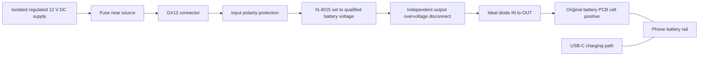

# Budget ideal diodes, GX12 power, and a printed rear cover

[Mona documentation](README.md) · [USB-C protection and software policy](usb-power.md)

Research date: **2026-10-16**. These are purchasing candidates and a proposed
mechanical layout. No listed board has been electrically qualified on Mona.
The existing phone measurements were about 4.17 V at the battery rail; that is
an observation, not a complete permissible voltage specification.

## What to buy

Look for an **ideal diode with output-to-input reverse-current blocking**.
“Anti-reverse connection” can mean only reversed-polarity protection, which
does not necessarily stop USB charging current reaching the XL4015 output.
The board must start and work at the lowest actual supply voltage, including
lead drop and load transients. A 5 V minimum board is unsuitable here.

### AliExpress shopping leads

Direct AliExpress product pages could not be retrieved during this research.
The links below were discovered through indexed listings; current price,
availability, selected variant, and correspondence with the linked seller
documents are **unverified**. Listings can change. Use the search phrases if a
link disappears, and compare the exact board, controller marking, and schematic
before ordering. No reliable current AliExpress price is quoted.

| Module/search phrase | AliExpress lead | Assessment for the roughly 4.2 V buck output |
| --- | --- | --- |
| `XL74610L ideal diode 1.5-36V` | [Item 1005009032912562](https://www.aliexpress.com/item/1005009032912562.html) | Small budget experiment candidate. The [seller's module document](https://ae01.alicdn.com/kf/Sfaf6b8344406433d961f7bea0e8969d61.pdf) claims 1.5–36 V operation and advertises 15 A without a heatsink under its stated test conditions. Treat those as seller claims; qualify the actual board at 4.2 V, including startup and idle behavior. |
| `LTC4359 4V 70V ideal diode module` | [Item 32928133399](https://www.aliexpress.com/item/32928133399.html) | Candidate if the seller supplies an identifiable controller and schematic. The listing family advertises 4–70 V/15 A; genuine [LTC4359 controllers](https://www.analog.com/en/products/ltc4359.html) support 4–80 V. The chip specification does not establish the module's limits. Startup margin near 4.17 V is small, and this may cost more delivered than the documented alternatives below. |
| `LM74700 5-30V 10A ideal diode` | [Item 1005002065181081](https://www.aliexpress.com/item/1005002065181081.html) | **Reject for the battery-side rail** when sold with the [5–30 V module specification](https://ae-pic-a1.aliexpress-media.com/kf/Ae141971ebee94654a1546ea90f432969S.pdf). The controller name does not override the board's minimum voltage. Input-side use at 12 V would need separate qualification and would not replace an output blocker. |

For an AliExpress experiment, request the **XL74610L** board's schematic first,
or choose the **LTC4359** family if its implementation is documented. Neither
is a qualified unattended-use recommendation. Buy a sample before designing
the cover around it; PCB outlines and terminals vary between sellers.

The XL74610L seller also reports about 0.3 V drop at very light load, with
improvement above approximately 10 mA in its 12 V test. That is another reason
to check idle behavior at the phone's actual voltage, rather than infer it
from the high-current rating. [Seller's operating cautions](https://ae01.alicdn.com/kf/Sfaf6b8344406433d961f7bea0e8969d61.pdf).

One particular concern with modules advertised as LM74610 replacements is
their conduction cycle. TI's actual LM74610-Q1 initially conducts through the
MOSFET body diode and periodically returns to that path to recharge its gate
drive. That can produce appreciable voltage dips on a low-voltage battery rail.
An XL74610L name does **not** prove it uses TI's chip or the same circuit; inspect
the implementation and scope its output. A multimeter reading alone will miss
short disturbances. [TI LM74610-Q1 datasheet, sections 7.3 and 8.2](https://www.ti.com/lit/ds/symlink/lm74610-q1.pdf).

### Small, inexpensive alternatives with manufacturer documentation

These are useful price references even if AliExpress is preferred. Prices are
single-unit manufacturer prices observed on the research date, before shipping
and tax. Check stock and delivery at checkout; backorders are offered.

| Board | Observed price | Bare PCB footprint | Published specifications |
| --- | --- | --- | --- |
| [Pololu #5382](https://www.pololu.com/product/5382) | US$3.79 | 7.62 × 12.7 mm | 4–60 V, 10 A, MOSFET resistance below 10 mΩ; explicit reverse-current blocking. |
| [Pololu #5383](https://www.pololu.com/product/5383) | US$4.95 | 7.62 × 12.7 mm | 4–60 V, 12 A, MOSFET resistance below 5 mΩ; explicit reverse-current blocking. |
| [Pololu #5388](https://www.pololu.com/product/5388) | US$6.49 | About 11.05 × 17.78 mm | 4–60 V, 20 A, MOSFET resistance below 3 mΩ; larger alternative from the original investigation. |

**My first compact prototype choice is #5383**, based on its documentation,
size, and low resistance. All three require at least 4 V at startup and can
operate down to 3.2 V afterward. Verify cold startup at the lowest actual input;
the phone's observed 4.17 V leaves limited margin. Their advertised current
ratings do not establish continuous capacity inside a warm printed cover.
Allow room for wires, insulation, and strain relief beyond the PCB outline.

Order the exact **ideal-diode** variant. Similar Pololu parts #5358, #5359,
#5380, #5381, #5386, and #5387 provide reverse-voltage protection while allowing
reverse current. A cheap single-MOSFET polarity protector or a “30 A” label is
not evidence of the required function. [Pololu variant comparison](https://www.pololu.com/product/5382).

## Proposed GX12 layout

The GX12 pin count, contact rating, and external supply are not yet specified.
The following is a **proposed 12 V DC input architecture**, not a pinout for the
connector already owned. Never connect 12 V to the battery PCB or phone rail.

This shows the positive power path and protection functions, not a finished
schematic. The overvoltage disconnect still needs component selection and
threshold/transient qualification. Route the return through the original
cell-negative connection and retain the PCB's protection/sense topology.
Ground-referenced blocker modules connect to the supply/cell-side return as
specified by their manufacturer. Do not bridge a protected or sensed negative
terminal. USB/PC grounds can create an unintended bypass; inspect the complete
ground path because the XL4015 is not isolated.

The ideal diode belongs **after the buck**. Keep the buck's feedback on its own
output and retain its output capacitors. An input-only diode cannot stop
current entering the buck's output. Independent output overvoltage protection
addresses a different fault: a failed buck could expose the phone to its higher
input voltage. A fuse or ideal diode alone does not stop forward overvoltage.

USB charging can still raise the rail on the **phone side** of the ideal diode.
The diagram does not contain that energy: a separately qualified disconnect of
incoming charging power, or an appropriate source/sink battery emulator, is
needed to contain that fault. Do not treat a generic TVS or a 4.2 V zener as a
continuous precision voltage regulator. See [USB protection](usb-power.md).

### Inside or outside the cover?

| Arrangement | Benefit | Cost |
| --- | --- | --- |
| GX12 carries 12 V; XL4015 and blocker inside | Short high-current battery wiring and lower cable current. Fits the integrated appliance concept. | Adds converter heat, switching circuitry, and a higher-voltage supply inside the phone enclosure. |
| XL4015 outside; GX12 carries the qualified battery voltage | Keeps converter heat outside and makes bench servicing easier. | More current through the cable/connector; resistance and startup voltage drop matter much more. |

For scale only: a hypothetical 4.2 V × 5 A load is 21 W. At an assumed 90%
efficiency, a 12 V input would supply about 1.94 A and the converter would
dissipate about 2.33 W. These are **illustrative calculations**, not measured
Mona consumption or measured XL4015 efficiency. Several watts inside the cover
can compete with processor cooling.

I would qualify the circuit outside the phone first, then use a raised,
removable electronics section in the new cover if internal temperatures allow.
The [XL4015 datasheet](https://www.xlsemi.com/datasheet/XL4015-EN.pdf) specifies
8–36 V input; a normal 5 V supply is not an appropriate input for this converter.
Its 5 A chip rating does not qualify a particular cheap module at 5 A in a case.
Keep 12 V and battery-voltage cables mechanically incompatible, or use only
one final connector scheme with clear labels; mixing them could destroy the
phone.

### GX12 wiring and mounting

- Verify the exact connector's drawing, contact rating, and numbered pin view.
  GX12 does not define a universal power pinout. For example, one
  [Renhotec GX12 family](https://renhotec-industrial.com/product/gx12-butt-joint-type-male-plug-threaded-cable-mount-solder-silver)
  lists 5 A for 2–4 contacts and 3 A for 5–7 contacts. Those are not ratings for
  an unidentified connector. Confirm both mating halves and the cable.
- Use a recessed/socket-contact source end so a disconnected powered cable has
  no exposed live pins. Verify continuity from the actual contact numbers;
  mating and solder views can be mirrored. Label voltage and polarity at both
  ends. Leave unused contacts insulated; do not assume paralleling contacts
  increases the rating.
- Use low-voltage DC only. Disconnect power before mating/unmating unless the
  specific connector is rated to switch that load. Size the source fuse for
  the cable and weakest contact, allowing measured startup current; the buck's
  output-current label is not an input fuse specification.
- Reinforce the mount with a boss/backing washer and strain relief. Measure the
  actual cutout, nut, solder cups, and wire bend clearance before CAD; the GX12
  label alone does not define those dimensions. Keep the shell away from live
  pads and do not use it as the power return.

## Printed rear-cover design notes

- **Measure the actual parts first.** Reserve height for the XL4015 inductor,
  capacitors, adjustment control, wiring, and insulation. Provide access to the
  fuse/disconnect and protected test points on both sides of the blocker. Keep
  the USB-C port, stylus, power button, cameras, and service screws accessible.
- **Support boards and wires mechanically.** Use standoffs and an insulating
  barrier under solder joints. Avoid pressure on the retained battery PCB,
  flex cables, or sensor wiring. Adhesive alone is poor strain relief for a
  locking metal connector.
- **Give the converter its own heat path.** Avoid dumping its heat into the
  processor heatsink. Preserve existing shields and thermal interfaces, and
  use electrically insulating thermal interfaces where needed. The XL4015
  package tab is a switching node, not a ground heatsink attachment point;
  check the [pinout](https://www.xlsemi.com/datasheet/XL4015-EN.pdf) before adding
  metal cooling hardware.
- **Leave antenna and coil clearances.** Map antennas, NFC and any wireless
  charging coil before adding metal or locating the buck inductor. Check RF
  performance after assembly. Keep wireless charging disabled/disconnected
  unless its incoming-power path is also qualified.
- **Choose filament using measured temperatures and mounting loads.** PLA can
  serve for a fit prototype. PETG or ASA are candidates for the working cover,
  subject to the particular filament's thermal/creep data; neither name alone
  establishes a flame rating or certified electrical insulation. Prusa's
  [PETG](https://help.prusa3d.com/article/petg_2059) and
  [ASA](https://help.prusa3d.com/article/asa_1809) guides discuss their differing
  heat resistance. Leave thermal margin, especially near inserts and the GX12
  mount. A modified/vented cover should not retain the original water-resistance
  assumption; keep conductive printer debris away from electronics.

## Qualification before enclosing it

Start with the phone disconnected and a current-limited supply/electronic load:

1. Check polarity, cold startup, voltage drop, and temperature over the intended
   input range and measured load peaks. Scope startup, load steps, load removal,
   and extended light-load operation on **both sides** of the blocker. Do not
   raise idle voltage to conceal inadequate wiring or a diode's voltage loss.
2. Use a current-limited bench arrangement to test output-powered/input-off
   behavior and switching between supplies. Measure reverse current with a
   suitable series instrument/shunt; never place an ammeter across the rail.
   Verify any overvoltage disconnect on the bench before connecting the phone.
3. After bench qualification, measure phone-side voltage and reverse current
   during the intended USB roles, source attachment/removal, boot, and shutdown.
   Hardware must remain effective before Magisk starts. Preserve voltage,
   current, temperature, and hardware protection signals.
4. Repeat realistic sustained load and idle tests inside the final cover at the
   expected ambient temperature. Record converter, connector, case, and phone
   temperatures, CPU throttling, network performance, and USB serial reliability.
   Inspect the wiring after thermal cycling before unattended use.

The [userspace charging-inhibit service](https://github.com/BGW-10/klipper-android-appliance-scripts/blob/mona-appliance/docs/mona-appliance.md#optional-charging-inhibition)
is the additional software layer after electrical qualification. Keep its two
enable/qualification flags off until then. Manual [fake SOC](fake-soc.md) changes
reported capacity; it does not inhibit charging or replace electrical protection.
No automatic fake SOC, thermal bypass, or kernel source change is required for
this hardware plan.
