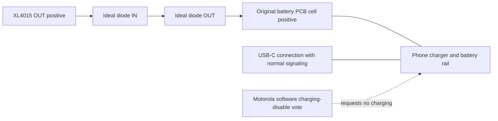

# USB-C with hardware and software protection for the XL4015

[Mona documentation](README.md)

Recommendations investigated on 2026-10-16. This supplements
[the appliance investigation](appliance.md). No charging controls were written on the
phone, no hardware was tested, and no Magisk changes were installed.

## Recommended two layers

1. Put a documented **reverse-current-blocking ideal diode** on the XL4015's
   output, before the battery PCB's original cell input. This protects the buck
   without interrupting USB data, CC signaling, or VBUS detection.
2. After electrically qualifying that protection, use Motorola's existing
   **charging-disable vote** as a software safeguard. Make one Magisk/service
   component responsible for applying it, detecting failures, and checking its
   effect across USB attachment and firmware restarts.

These layers address reverse current into the converter. They do not establish
that the phone's replacement battery rail is safe under every charging fault.
Blocking reverse current leaves any incoming charge energy on the phone side.
If that voltage rises above the qualified range, disconnect the incoming USB
power path or use a properly rated source/sink battery simulator. A supply-side
OVP switch cannot clamp voltage supplied from the opposite side.



Install with all supplies disconnected. Connect the board's ground to the
original supply/cell-negative return as its documentation requires. Keep the
battery PCB's protection and sense path intact. Do not bond around a protected
or sensed negative terminal. Check whether the PC, hub, and external DC supply
create a ground path that bypasses a low-side battery protection device; the
XL4015 itself is not an isolated converter.

Place the blocker on the **buck output**, not just its input. Keep the buck's
own feedback sensing on its own output; do not improvise remote feedback after
the blocker. Retain its original output capacitors. Qualify any extra output
capacitance, load steps, and startup sequence again after inserting the board.

## Hardware candidates

These are manufacturer-documented candidates, not tested Mona accessories.
Choose one after establishing peak current and minimum startup voltage.

| Candidate | Useful features | Important tradeoff |
| --- | --- | --- |
| [Pololu #5388 ideal diode, 4–60 V](https://www.pololu.com/product/5388) | Explicit reverse-current blocking; low-resistance external MOSFET, specified below 3 milliohms; manufacturer rates the board around 20 A continuous. | Needs at least 4 V to start, though it can operate down to 3.2 V afterward. At the observed roughly 4.17 V supply, startup margin needs measurement. It does not supply a battery-rail voltage clamp or a new current limit. |
| [Adafruit #6359 LM73100 breakout](https://www.adafruit.com/product/6359) | Convenient terminal blocks; about 3–23 V board operating range; up to 5 A; reverse-current blocking and current-monitor output. | Roughly 30 milliohms means approximately 0.15 V drop and 0.75 W at 5 A. Check thermal behavior and transient peaks; 5 A is a ceiling to qualify, not spare capacity. |
| [TI TPS25947EVM / TPS25947](https://www.ti.com/product/TPS25947) | Evaluation platform for a reverse-blocking eFuse with configurable protection; 2.7–23 V family, up to 5.5 A. | More configuration work. Review the fitted variant, UVLO/OVP, current limit, and startup settings before using it near 4.2 V. Input protection does not regulate externally driven output voltage. |

My first low-loss candidate for the currently observed supply is Pololu #5388,
provided it starts reliably at the lowest actual buck voltage. Adafruit #6359
is convenient for a prototype with measured current comfortably within its
rating, but its voltage drop matters on a battery rail. These recommendations
are engineering judgments based on the published specifications.

Do not substitute a similarly named **reverse-polarity-only** protector. For
example, Pololu also sells versions that intentionally allow current to flow
back to the supply; order the exact reverse-current-blocking version. A simple
Schottky diode is possible but introduces a larger load-dependent voltage drop
and heat. Do not compensate by blindly increasing the buck setting: verify
phone-side voltage at idle, full load, and load removal.

For the LM73100, [Adafruit documents IN, OUT, GND, and monitor pins](https://learn.adafruit.com/adafruit-lm73100-ideal-diode-breakout/pinouts).
No header/breadboard current rating is implied by the chip rating; use suitable
power connections. Its IMON output is not by itself a calibrated reverse-current
detector. Check actual reverse current with an appropriate bidirectional
measurement setup, including input-off and hot-plug cases. Real devices have
leakage and finite switching response; do not assume mathematically zero
current at every instant.

## Choose the USB connection for its role

The live phone currently reports `data_role=[host] device` and
`power_role=[source] sink`; its Ethernet adapter is a downstream peripheral.
Both USB and wireless input report `online=0`. That is a useful operating
arrangement, not a guarantee about another cable or dock.

| Use | Recommended arrangement | What to avoid assuming |
| --- | --- | --- |
| Ethernet/CP210X/peripherals, phone is host | USB-C host adapter and peripheral/hub with no upstream charging path. For separately powered peripherals, use a self-powered hub whose manufacturer confirms upstream backfeed prevention, then measure it. Keep PD charging inputs disconnected. | A powered hub or a port labelled “data” is not automatically isolated. Host devices may still need phone-sourced VBUS for detection. |
| PC ADB or USB gadget networking, phone is a device | Preserve normal USB signaling and VBUS detection; protect the buck at its output and inhibit charging through the tested software control. Use network ADB/SSH when the USB cable is unnecessary. | Simply cutting VBUS can prevent enumeration. Preserving VBUS while inhibiting charging requires phone cooperation or a purpose-designed interface. |
| Switching between both roles | Keep the battery-side blocker installed and validate both roles, each cable orientation, and each attached device. | A one-way USB power interposer for host mode is not a general dual-role/PD solution. |

I did not find enough evidence to certify a particular generic USB-C
“power-blocking” dongle for both Mona roles. Acroname explains that
[phones commonly interpret missing VBUS as host disconnection](https://acroname.com/blog/can-acroname-hub-create-data-only-usb-connection-phone).
A USB **data blocker** does the opposite of this task: it retains charging and
removes data. A USB isolator can still provide downstream power, so isolation
alone is not evidence that charging is blocked.

If a custom host-only USB interposer is used, its reverse blocker would pass
power from phone to peripheral and reject peripheral-to-phone current. CC and
data wiring must remain correct. This needs USB electrical validation and is
not a reason to splice a generic high-speed USB-C cable. An inline USB power
meter is a diagnostic instrument unless it explicitly implements the required
blocking; do not count it as a protection layer.

## Software: Motorola's charging-disable vote

The running phone exposes this root-writable, **write-only** node:

```text
/sys/class/power_supply/battery/device/force_charging_disable
```

Its resolved device path is:

```text
/sys/devices/platform/soc/soc:qcom,pmic_glink/soc:qcom,pmic_glink:qcom,battery_charger/force_charging_disable
```

Related Motorola [mmi_charger source](https://github.com/MotorolaMobilityLLC/motorola-kernel-modules/blob/78c22b4ec0a515803ed215cdf7311bd0ea1aaee2/drivers/power/mmi_charger/mmi_charger.c)
maps a nonzero write to the `MMI_USER` charging-disable vote and schedules policy
work. Its [GLINK driver](https://github.com/MotorolaMobilityLLC/motorola-kernel-modules/blob/78c22b4ec0a515803ed215cdf7311bd0ea1aaee2/drivers/power/qti_glink_charger/qti_glink_charger_core.c)
sends `OEM_PROP_CHG_DISABLE` separately from charger suspend. This makes charging
disable the first candidate for retaining USB data while inhibiting battery
charging. Firmware behavior still needs measurement.

The inspected public revision is from
`android-16-release-w1vas36.62-22-16-16`; it is **not established as the exact
source of the installed W1VAS36.62-22-26-7-2-3 modules**. Live node names and
permissions match, but no write or electrical test was performed. The linked
implementation can also override disable with `force_charging_enable=1`.
The live `force_charging_enable` and `force_charger_suspend` both read `0`.

First attended experiment, only after installing and qualifying hardware
protection and keeping other charging-management scripts inactive. Run inside
`adb shell`, then `su`:

```sh
mona_chg=/sys/class/power_supply/battery/device
if [ "$(cat "$mona_chg/force_charging_enable")" != 0 ]; then
    echo 'Conflicting forced-charging policy; investigate its owner.' >&2
elif [ ! -w "$mona_chg/force_charging_disable" ]; then
    echo 'Motorola charging-disable control unavailable.' >&2
else
    printf '1\n' > "$mona_chg/force_charging_disable" ||
        echo 'Charging-disable write failed.' >&2
fi
```

After policy work has run, record battery status/voltage/current, USB data
operation, and **external current direction and rail voltage** while connecting
the intended USB source. Software status alone is insufficient. The control
does not have a readable previous value: coordinate ownership of `MMI_USER`
instead of assuming a safe state can be backed up with `cat`.

After removing external charging sources and ensuring the test owns that vote,
remove the test's user inhibit with:

```sh
printf '0\n' > /sys/class/power_supply/battery/device/force_charging_disable
```

This removes that user vote; it does not force charging through other safety
votes. Do **not** use `force_charging_enable=1` as a rollback command.

`force_charger_suspend=1` is a separate, broader candidate if charging disable
does not suffice. It may change input power availability or USB behavior and
needs its own experiment; preserve its previous readable value. A charging
inhibit requests firmware behavior and does not physically disconnect the rail.

## Qualcomm alternatives and reset limitations

These controls already exist with the current kernel. They do not require
`CONFIG_QTI_PMIC_GLINK_CLIENT_DEBUG`, and that flag is not a charging-safety
option. Prefer the Motorola policy path above before combining multiple owners
of charging state.

| Control | Local source behavior | Limitations |
| --- | --- | --- |
| `qcom-battery/restrict_cur=0`, then `restrict_chg=1` | Requests a zero fast-charge-current limit; retains the minimum of restriction and thermal limits. | Acceptance of a zero value by firmware and OEM interaction need testing. Readback is cached driver state. Save both original values if testing. |
| `power_supply/usb/input_current_limit=0` | The driver explicitly describes zero as input suspend. | Setter accepts only SDP, CDP, or PD adapter classifications; other types, including the current host/unknown state, can reject it. Data enumeration must be tested. |
| Negative USB input-current limit | Converted to an unrestricted/released request by the driver. | It releases the limit; it is not a stronger inhibit. Do not use an arbitrary negative number as a safety control. |

Inspection of [qti_battery_charger.c](../../drivers/power/supply/qti_battery_charger.c)
found an important reset edge case: `subsys_up_work()` restores FCC/ICL only
when their cached values are nonzero. A zero FCC or zero ICL request is skipped
after GLINK restart. The transport can also return success without transmitting
while GLINK is down. Consequently a successful shell write, or a readback of
zero, does not prove continued firmware enforcement.

This is a concrete reason to keep hardware protection independent. If the
Qualcomm zero-limit approach becomes necessary, a useful future C change would
track “request valid” separately from the numeric value and restore valid zero
requests after recovery, with handling for adapter-type changes. That patch
would still not protect bootloader time or eliminate the need for measurement.
No C change is included here.

Do not substitute fake SOC, `dumpsys battery unplug`, thermal charge-control
indices, factory mode, PMIC register pokes, or battery-debug votable overrides.
They either do not physically inhibit charging or change broader policies.
`charge_control_en` enables SOC-threshold charge management, not a master
charger-off switch.

## Magisk integration requirements for the separate userspace repository

- Keep this as a distinct optional **charging-inhibit policy**, separate from
  manual fake SOC. Do not activate fake SOC at boot as part of this change.
- Use one owner of the Motorola vote. Check for conflicting `force_charging_enable`
  or other charging managers; log failures instead of assuming success.
- Apply after the driver's sysfs node appears, with bounded retries. Do not wait
  for `sys.boot_completed` unnecessarily, but acknowledge that Magisk still
  cannot cover the bootloader/early-boot interval.
- Re-evaluate after attach/detach, role changes, and GLINK/charger recovery.
  Verify actual effects; repeated writes of the same cached value may not cause
  a new firmware transaction. Avoid toggling charging on just to force a refresh.
- Monitor rail voltage, status/current, USB role, and input online state. Calibrate
  current sign externally; a slow poll cannot catch every transient. Log and
  disconnect the incoming charging source on a detected failure. Simply asking
  Android to shut down is not proof that off-mode charging stops.
- Keep the hardware blocker functional if the script, Android, or firmware
  stops. If unattended rail overvoltage must also be contained, add an
  independently controlled disconnect in the incoming charging path or use a
  qualified source/sink supply. A random 4.2 V zener/TVS is not a precision,
  continuous charging-energy sink.

## Qualification before counting this as two working layers

Test the blocker first with a current-limited bench setup and a load, including
output externally powered while input is off. Check leakage/transient reverse
current and avoid shorting a live rail with an ammeter. Then qualify it with
the phone, protection PCB, and actual USB arrangement.

Check cold boot, reboot, each USB role/orientation, source hot-plug, external
input removal, and the intended sustained workload. Verify both converter-side
reverse current and phone-side peak voltage. Account for wireless charging too.
Only test firmware recovery while attended with recovery access; do not provoke
a subsystem crash on the appliance merely to exercise the script.

The hardware branch and software command are presently recommendations. The
live investigation confirmed nodes, source relationships, and USB roles; it did
not demonstrate charge inhibition or qualify a purchased blocker board.
